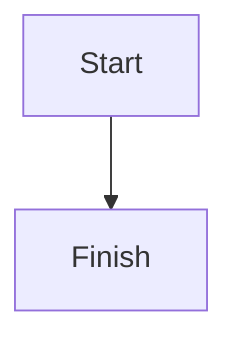

# Logbook

A minimalist, Markdown-first personal publication and observations site built with Astro.

## Requirements

- Node.js 20.3+ (recommended)
- npm, pnpm, or bun

## Local development

```bash
npm install
npm run dev
```

## Configuration

The project defaults to deployment at `https://geetansh.tech/logbook` or `https://geetansh.tech`.

Set these environment variables in your deployment settings:

```env
PUBLIC_BASE_PATH=/logbook
SITE_URL=https://geetansh.tech
```

For a root domain or dedicated subdomain such as `https://logbook.geetansh.tech`, use:

```env
PUBLIC_BASE_PATH=/
SITE_URL=https://logbook.geetansh.tech
```

`PUBLIC_BASE_PATH` controls Astro's base path. `SITE_URL` is the canonical origin used by feeds and sitemap generation.

## Content Structure

All articles and observations are located in the root `./content/` folder:

```text
content/
├── logbook/
│   ├── understanding-llms/
│   │   └── index.md
│   └── building-a-personal-site-with-astro/
│       ├── index.md
│       └── architecture.svg
└── observations/
    ├── fast-is-not-the-skill/
    │   └── index.md
    └── micro-models/
        └── index.md
```

Each article or observation has its own dedicated directory. Any images, diagrams, or other files used in that article are colocated directly within the article's subfolder and can be referenced via relative paths (e.g. `./architecture.svg`).

### Writing a new logbook article

Create a folder inside `content/logbook/<slug>/`, for example `content/logbook/my-new-article/index.md`:

```yaml
---
title: "My new article"
description: "A short summary for the index and feeds."
date: 2026-11-06
tags: [Technology, Notes]
category: Technology
draft: false
---

Start writing here...
```

Set `draft: true` to keep an article out of the published site and all feeds. Set it to `false` when ready.

### Images

Colocate images in the article's subfolder (e.g. `content/logbook/my-article/diagram.png`) and reference them directly via `./diagram.png`. Astro automatically bundles, optimizes, and serves them. Clicking any image opens the minimal square-corner lightbox with zoom and pan support.

### Diagrams

Use Mermaid fenced blocks:

````markdown

````

Mermaid diagrams automatically adapt to light/dark mode and whichever theme palette is currently selected. Clicking on a Mermaid flowchart opens the zoomable lightbox modal.

### Mathematics

Inline: `$E = mc^2$`

Block:

```markdown
$$
E = mc^2
$$
```

KaTeX rendering is enabled through `remark-math` and `rehype-katex`.

## Themes & Easter Egg

- **Dark / Light Mode**: Follows browser/system preferences automatically, and can be manually toggled via the sun/moon button in the header.
- **Palette Easter Egg**: Four continuous taps on the word **logbook** or **observations** in the title cycles through 15 curated color palettes (Cursor, Slate, Void, Obsidian, Ash, Charcoal, Graphite, Sepia, Sable, Noir, Fog, Steel, Stone, Silver, and Monochrome).
- **Reset to Original**: Touch and hold (long press) on the title resets the theme back to the original Cursor theme and follows the browser light/dark setting.

## Routes

- `/` — publication homepage (logbook list)
- `/logbook/` — all logbook articles
- `/logbook/<slug>/` — individual article page
- `/observations/` — short thoughts and observations
- `/observations/<slug>/` — individual observation view
- `/archive/` — all published articles
- `/about/` — about page
- `/tags/<tag>/` — tag archive
- `/rss.xml` — RSS feed endpoint
- `/atom.xml` — Atom feed endpoint
- `/feed.json` — JSON Feed endpoint
