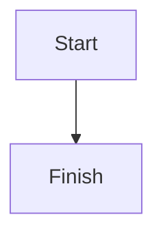

# Writings

A minimalist, Markdown-first personal publication built with Astro.

## Requirements

- Node.js 20.3+ (recommended)
- npm, pnpm, or bun

## Local development

```bash
npm install
npm run dev
```

## Configuration

The project defaults to deployment at `https://geetansh.tech/writings`.

Set these environment variables in your deployment settings:

```env
PUBLIC_BASE_PATH=/writings
SITE_URL=https://geetansh.tech
```

For a dedicated subdomain such as `https://writings.geetansh.tech`, use:

```env
PUBLIC_BASE_PATH=/
SITE_URL=https://writings.geetansh.tech
```

`PUBLIC_BASE_PATH` controls Astro's base path. `SITE_URL` is the canonical origin used by feeds and sitemap generation.

## Writing a new article

Create a Markdown file inside `src/content/writings/`, for example `my-new-article.md`:

```yaml
---
title: "My new article"
description: "A short summary for the index and feeds."
date: 2026-11-04
tags: [Technology, Notes]
category: Technology
draft: false
---

Start writing here...
```

Set `draft: true` to keep an article out of the published site and all feeds. Set it to `false` when ready.

### Images

Put images in `public/media/`. When deploying under `/writings`, reference them with `/writings/media/image-name.png`; on a dedicated subdomain, use `/media/image-name.png`. The RSS generator converts `/media/` image references to absolute URLs.

### Diagrams

Use Mermaid fenced blocks:

````markdown

````

Mermaid diagrams are enhanced in the browser. RSS clients do not execute JavaScript; for important diagrams, export them as SVG and embed the SVG image as well.

### Mathematics

Inline: `$E = mc^2$`

Block:

```markdown
$$
E = mc^2
$$
```

KaTeX rendering is enabled through `remark-math` and `rehype-katex`.

## Routes

- `/` — publication homepage (under the configured base path)
- `/archive/` — all published articles
- `/about/` — about page
- `/<slug>/` — article page
- `/tags/<tag>/` — tag archive
- `/rss.xml` — RSS feed endpoint
- `/atom.xml` — Atom feed endpoint
- `/feed.json` — JSON Feed endpoint

## Deployment

1. Push this repository to GitHub.
2. Import it into Vercel, or enable GitHub Pages.
3. Set `SITE_URL` and `PUBLIC_BASE_PATH` correctly.
4. Build command: `npm run build`.
5. Output directory: `dist`.

A GitHub Actions workflow for GitHub Pages is included in `.github/workflows/deploy.yml`.

## Current implementation notes

- RSS includes sanitized full-text HTML generated from the Markdown source. Atom and JSON Feed include article metadata; JSON Feed also includes the source text.
- The Markdown pipeline currently supports Astro's built-in GFM-like Markdown and Shiki highlighting. For KaTeX and footnotes, add `remark-math`, `rehype-katex`, and a footnote plugin and wire them into `astro.config.mjs`.
- Search is intentionally not included in the first implementation; it can be added as a small client-side index after the content model is stable.
